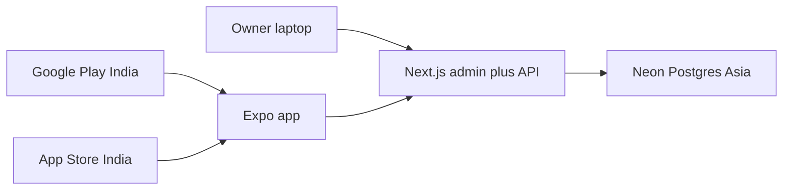

# Apna Kirana — India kirana, store-ready, cheap to run

This is a **single neighbourhood kirana in India**, not a US grocery or marketplace. Copy, money, phone, address, time, and store listing are **India-only**. Reference: [Minute Bazar](https://play.google.com/store/apps/details?id=com.minutebazar).

**Release:** customer app on **Google Play (India)** and **Apple App Store (India)**. Owner uses **laptop Chrome**. Availability country: **IN** only.

**Pay:** **Cash on delivery** (`Ghar aane par nikaal dena`). Checkout shows **UPI — Coming soon**. Admin has the same disabled toggle for later.

**Run cost:** Vercel Hobby + Neon free (prefer **Asia** region, Mumbai/`ap-south-1` if listed). Expo EAS free tier. No Firebase, no Razorpay. Store accounts (you create, Indian GST billing): Play Console one-time fee (Google charges USD, paid from India with GST); Apple Developer India **₹ billed yearly** (Apple’s USD 99 + GST). Hosting stays ₹0.

Project: [`/Users/chandapr/Projects/apna-kirana`](/Users/chandapr/Projects/apna-kirana)

**After approve:** create folder, `git init`, `move_agent_to_root`, then scaffold.

## India defaults (non-negotiable in code)

- Locale `en-IN`, timezone `Asia/Kolkata`, currency **INR**, display **₹**, integers stored as **paise**
- Phone: **+91** and **10 digits**; no US formatting
- Address: house / gali / building, **landmark**, area, **6-digit PIN** — not ZIP, not US states
- Language: **Hindi + English** labels (Hinglish where it reads more natural)
- Units: kg, g, L, packet, pcs (kirana, not lb/oz)
- Dates/slots in **IST** (e.g. aaj shaam 5–7)
- Seed catalog: Indian staples (atta, chawal, tel, doodh, pyaaz, tamatar, masala)
- Stores: `in.apnakirana.app`, listing country **India**, no USD price strings

## Stack

- [`apps/web`](apps/web) — Next.js `/admin` + APIs
- [`apps/mobile`](apps/mobile) — one Expo app for Android + iOS
- OTP: Fast2SMS / MSG91 if a key exists; else OTP on admin screen for the dukaanidar to tell the customer

## UX (returning customer first)

Large taps, ₹, bilingual.

**Pehli baar:** 10-digit mobile → OTP → address with PIN + landmark → dukan.

**Phir se kholne par:**

- **Phir se order** (Buy again) — last bill, skip out-of-stock
- **Aapke regular** — items bought more than once
- Open order status on home
- Last address + last slot already selected

**Checkout:** only **Cash on delivery**. UPI row locked: **Coming soon**.

**Baad mein:** thank-you with IST slot; statuses placed → accepted → packed → out_for_delivery → delivered.

No wallet, no coupons at launch. Profile is name + mobile + address only.

## Notifications and later offers

v1 push (Hindi/English, IST): order **placed**, **accepted**, **nikal gaya**, **pahunch gaya**.

Not v1: festival sale blasts. Still in schema: `Offer` (`sale` | `discount` | `reminder` | `order`), home **banner/modal slot**, `mrpPaise` + `pricePaise` for later strikethrough MRP, admin **Offers — Coming soon**, hooks for “atta 20 din pehle liya tha”.

## Data

`Product`, `Customer`, `Address` (pin, landmark), `Order` + `OrderItem`, `OtpChallenge`, `PushToken`, `StoreSettings`, stub `Offer`. Stock down on accept, back on cancel.

## Owner admin

IST “aaj ke order”, low stock, prices in ₹, customers by mobile, history. COD on. UPI and Offers: **Coming soon**.

## Store listing (India)

EAS builds. Play Console + App Store Connect **India** storefront, privacy policy, Indian contact phone/email. README in INR/GST terms. You own the developer logins.

## Out of scope for v1

Live UPI, Razorpay, coupons, marketing SMS, rider GPS, multi-store, Firebase, US locale, PWA as the product.

## Implementation order

1. Repo with `en-IN` / IST / INR
2. Schema + +91 auth
3. Admin
4. Mobile shop, COD, Buy again
5. Push + empty offer slot
6. Verify admin in browser; Expo shop; India store checklist in README
